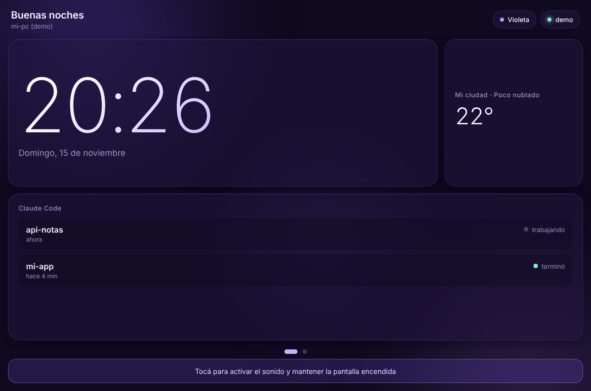
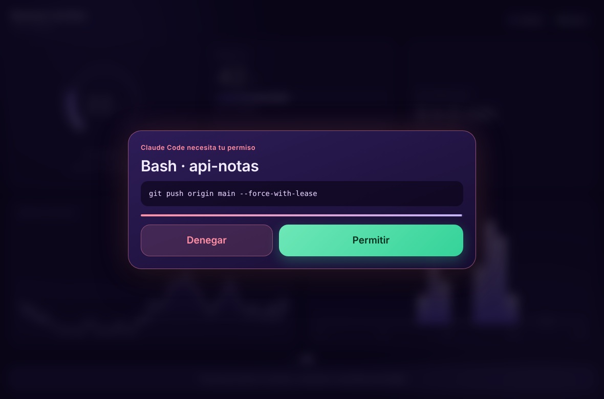
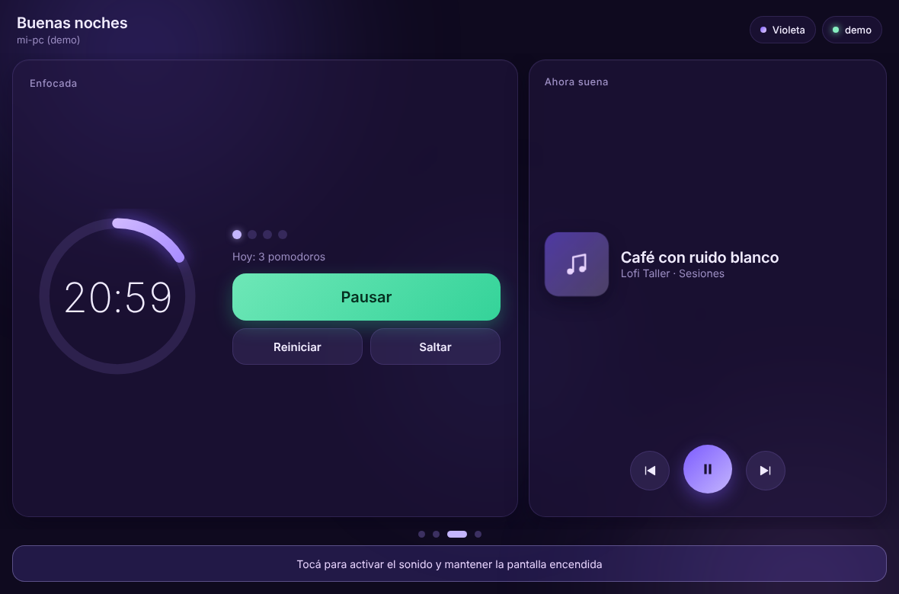
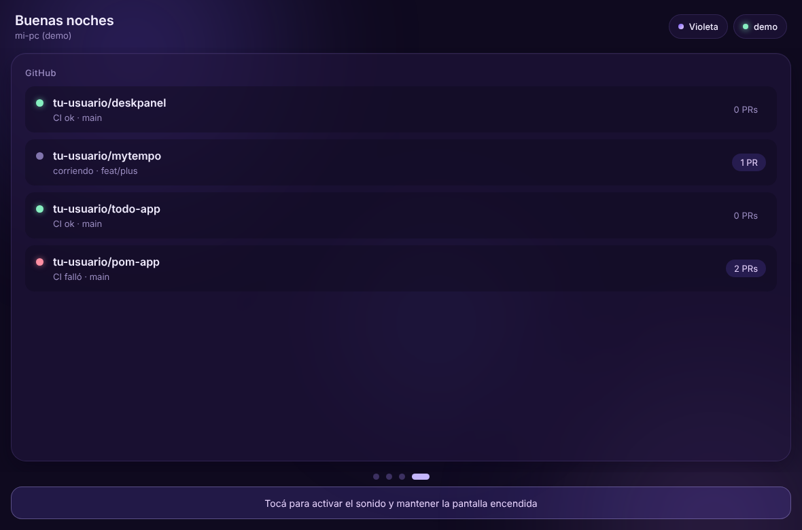
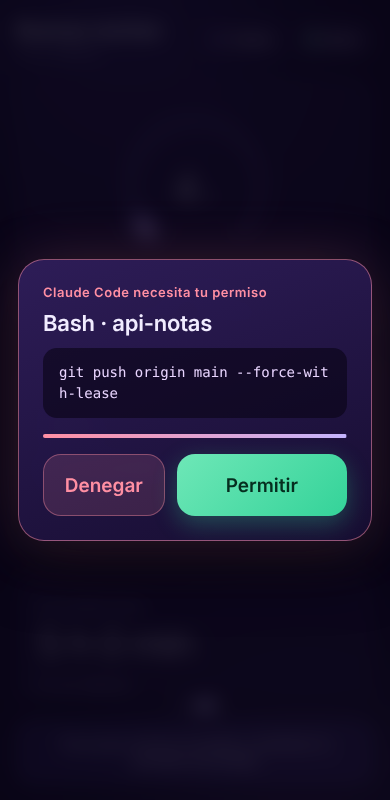

# deskpanel

[](https://github.com/mmodugno/deskpanel/actions/workflows/ci.yml)


Convertí un celular o una tablet vieja en un panel de escritorio para tu PC. Cuatro páginas que se deslizan: **Inicio** (reloj, clima, próximo evento y tus sesiones de **Claude Code**), **Sistema** (CPU y memoria con gráficos en vivo), **Foco** (pomodoro y música sonando) y **GitHub** (CI y PRs de tus repos). Cuando Claude Code pide permiso, el panel muestra el comando y lo aprobás o denegás con un toque.
Todo por la red local o por cable USB, **sin nube y sin cuentas**.

<p>
  
  
  
</p>
<p>
  
  
  
</p>
<sub>Capturas con datos de prueba.</sub>

**Demo en vivo:** https://mmodugno.github.io/deskpanel/panel/?demo (datos de mentira generados en el navegador).

## Cómo funciona

```
 Claude Code ──hooks──▶  ┌────────────┐   SSE (Wi-Fi o USB)   ┌──────────────┐
 CPU / RAM / clima ────▶ │   agente   │ ─────────────────────▶ │ panel (PWA)  │
                         │  Node.js   │                        │ celular/tablet│
                         └────────────┘                        └──────────────┘
```

- **Agente** (`agent/`): servidor Node sin dependencias. Mide el sistema, recibe los hooks de Claude Code y empuja los cambios al panel con Server-Sent Events.
- **Panel** (`panel/`): una PWA en JavaScript vanilla. Se abre desde el navegador del celular/tablet, se instala a pantalla completa y mantiene la pantalla encendida.
- **Seguridad**: cada arranque genera un token aleatorio; sin él, la API no responde. El token viaja en el link que imprime el agente y el panel lo guarda y lo saca de la barra de direcciones.

## Instalación

Guía paso a paso (arranque automático en Windows y Mac, y cómo instalar el panel en el celular como una app): **[docs/instalacion.md](docs/instalacion.md)**.

## Uso

Requisitos: Node 20 o más nuevo en la compu.

```bash
git clone https://github.com/mmodugno/deskpanel
cd deskpanel
npm start
```

La primera vez se abre en tu PC una página (`/pair`) con el link de conexión; también lo imprime en la consola. Abrilo en el celular o la tablet (misma red Wi-Fi), agregalo a la pantalla principal, tocá el botón para activar sonido y listo. La clave se guarda en `~/.deskpanel/token`, así que no hay que reconectar al reiniciar.

### Modo USB (sin abrir puertos en la red)

```bash
npm start -- --usb
```

En este modo el agente escucha solo en `127.0.0.1`, detecta el celular conectado y arma solo el puente `adb reverse` (también al reconectar). Necesita `adb` en la PC y la depuración USB activada en el celular una vez. Pensado para compus donde no querés exponer nada a la red.

### Configuración (opcional)

Todo lo personal va en `config.local.json`, que está en `.gitignore` (tu ubicación, tu calendario y tus repos no se suben):

```json
{
  "weather": { "latitude": 0.0, "longitude": 0.0, "name": "Mi ciudad" },
  "github": ["tu-usuario/un-repo", "tu-usuario/otro-repo"],
  "calendarUrl": "https://calendar.google.com/calendar/ical/.../basic.ics",
  "focus": { "workMin": 25, "breakMin": 5, "longBreakMin": 15, "cycles": 4 }
}
```

- **Clima:** [Open-Meteo](https://open-meteo.com), sin cuenta.
- **GitHub:** estado del último CI y PRs abiertos por repo con la API pública (60 pedidos por hora). Para repos privados definí la variable de entorno `GITHUB_TOKEN`.
- **Calendario:** la dirección secreta en formato iCal de tu calendario (en Google Calendar: Configuración → tu calendario → "Dirección secreta en formato iCal"). Entiende horas UTC, con zona horaria y de día completo, y repeticiones diarias y semanales simples (no `EXDATE` ni mensuales/anuales). Tratá esa dirección como una contraseña.
- **Slack (solo lectura):** DMs sin leer y menciones de hoy. Creá una app en [api.slack.com/apps](https://api.slack.com/apps) con estos *User Token Scopes*: `search:read`, `im:read`, `mpim:read`, `im:history`, `mpim:history` y `users:read`. Instalala en tu workspace y copiá el *User OAuth Token* (`xoxp-...`) en `config.local.json` como `"slack": { "token": "xoxp-..." }`, o en la variable de entorno `SLACK_TOKEN`. El agente solo llama a métodos de lectura (lista cerrada en `agent/src/slack.js`), aunque el token tenga más permisos. Sin token, la tarjeta avisa que está sin conectar. Muchas empresas piden que un admin apruebe las apps: consultá antes de instalarla.
- **Foco:** las duraciones del pomodoro. El temporizador vive en el agente, así que el celular y la tablet muestran lo mismo.
- **Música:** no necesita configuración. En Windows usa los controles multimedia del sistema (PowerShell), en macOS Spotify o Música (AppleScript) y en Linux `playerctl`. **Experimental:** está probado con salidas simuladas, no en equipos reales de cada sistema. Solo consulta mientras haya un panel conectado.

### Claude Code

Mirá [docs/claude-code.md](docs/claude-code.md) para conectar los hooks (estado de sesiones y aprobación de permisos desde el panel).

## Tests

```bash
npm test
```

69 tests con `node --test` (token, métricas, sesiones, permisos, pomodoro con reloj falso, GitHub y calendario con datos simulados, reproductor, servidor HTTP, SSE y funciones del panel). El CI corre en Ubuntu, Windows y macOS con Node 20 y 22.

## Estado y pendientes

- [x] Agente, panel, alertas, modo USB, gráficos en vivo, 4 temas con fondo animado, páginas deslizables, aprobar permisos desde el panel, modo demo, tests y CI
- [x] Pomodoro, GitHub, calendario y música sonando
- [ ] Probado en Windows y macOS reales (el desarrollo corrió en Linux; el CI cubre los tres sistemas, pero no el reproductor ni el cable USB)
- [ ] Carátula del disco en el reproductor
- [ ] Widget de cuotas de uso de Claude (depende de un endpoint no documentado; no se incluye a propósito)

## Créditos

Inspirado en la idea de [PhoneBox](https://github.com/ersinkoc/phonebox) (MIT, de ersinkoc). Este proyecto es una implementación independiente con otro stack.

## Licencia

MIT
