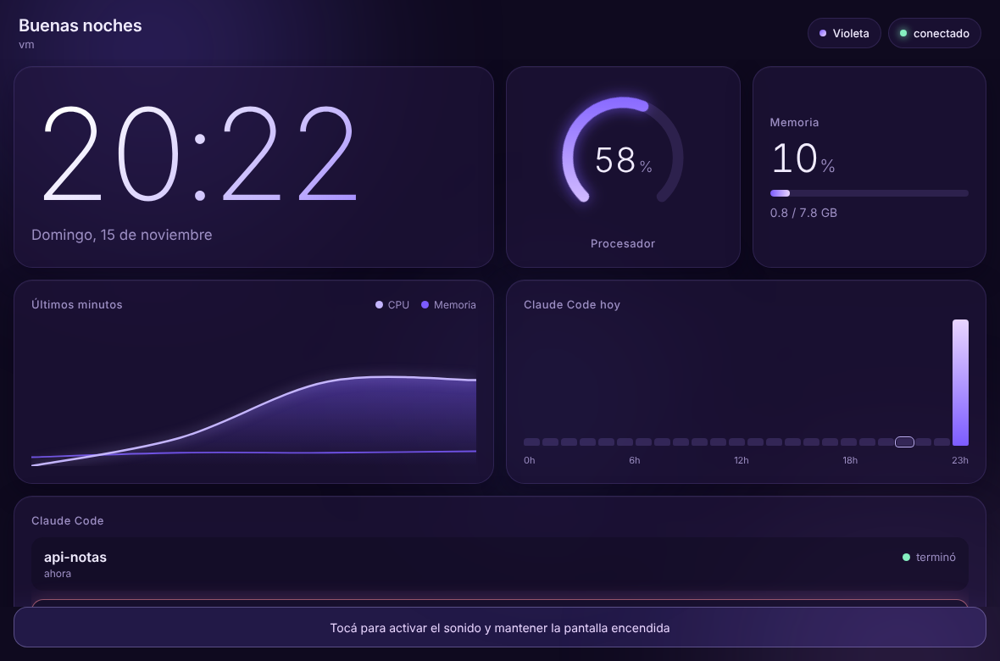
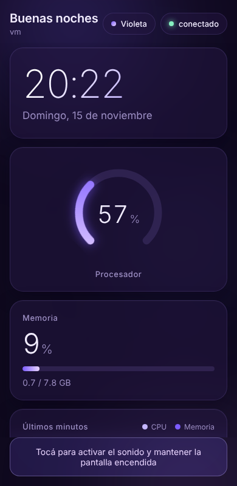

# deskpanel

[](https://github.com/mmodugno/deskpanel/actions/workflows/ci.yml)


Convertí un celular o una tablet vieja en un panel de escritorio para tu PC: reloj, CPU, memoria, clima y el estado de tus sesiones de **Claude Code** (te avisa con sonido y vibración cuando una te pide permiso o termina).
Todo por la red local o por cable USB, **sin nube y sin cuentas**.

<p>
  
  
</p>
<sub>Capturas con datos de prueba.</sub>

**Demo en vivo:** https://mmodugno.github.io/deskpanel/panel/?demo (datos de mentira generados en el navegador).

## Cómo funciona

```
 Claude Code ──hooks──▶  ┌────────────┐   SSE (Wi-Fi o USB)   ┌──────────────┐
 CPU / RAM / clima ────▶ │   agente   │ ─────────────────────▶ │ panel (PWA)  │
                         │  Node.js   │                        │ celular/tablet│
                         └────────────┘                        └──────────────┘
```

- **Agente** (`agent/`): servidor Node sin dependencias. Mide el sistema, recibe los hooks de Claude Code y empuja los cambios al panel con Server-Sent Events.
- **Panel** (`panel/`): una PWA en JavaScript vanilla. Se abre desde el navegador del celular/tablet, se instala a pantalla completa y mantiene la pantalla encendida.
- **Seguridad**: cada arranque genera un token aleatorio; sin él, la API no responde. El token viaja en el link que imprime el agente y el panel lo guarda y lo saca de la barra de direcciones.

## Uso

Requisitos: Node 20 o más nuevo en la compu.

```bash
git clone https://github.com/mmodugno/deskpanel
cd deskpanel
npm start
```

El agente imprime un link como `http://192.168.1.5:4747/?token=...`. Abrilo en el celular o la tablet (misma red Wi-Fi), tocá el botón para activar sonido y listo.

### Modo USB (sin abrir puertos en la red)

```bash
npm start -- --usb
adb reverse tcp:4747 tcp:4747
```

En este modo el agente escucha solo en `127.0.0.1` y el celular entra por el cable (necesita `adb` y depuración USB). Pensado para compus donde no querés exponer nada a la red.

### Clima (opcional)

Creá `config.local.json` (está en `.gitignore`, tu ubicación no se sube):

```json
{ "weather": { "latitude": 0.0, "longitude": 0.0, "name": "Mi ciudad" } }
```

### Claude Code

Mirá [docs/claude-code.md](docs/claude-code.md) para conectar los hooks.

## Tests

```bash
npm test
```

27 tests con `node --test` (token, métricas, sesiones, clima con fetch simulado, servidor HTTP, SSE y funciones del panel). El CI corre en Ubuntu y Windows con Node 20 y 22.

## Estado y pendientes

- [x] Agente, panel, alertas, modo USB, gráficos en vivo, temas, modo demo, tests y CI
- [ ] Widget de música sonando en Windows
- [ ] Widget de cuotas de uso
- [ ] Probado en Windows real (hoy el desarrollo corrió en Linux; el CI cubre Windows)
- [ ] Soporte macOS verificado

## Créditos

Inspirado en la idea de [PhoneBox](https://github.com/ersinkoc/phonebox) (MIT, de ersinkoc). Este proyecto es una implementación independiente con otro stack.

## Licencia

MIT
